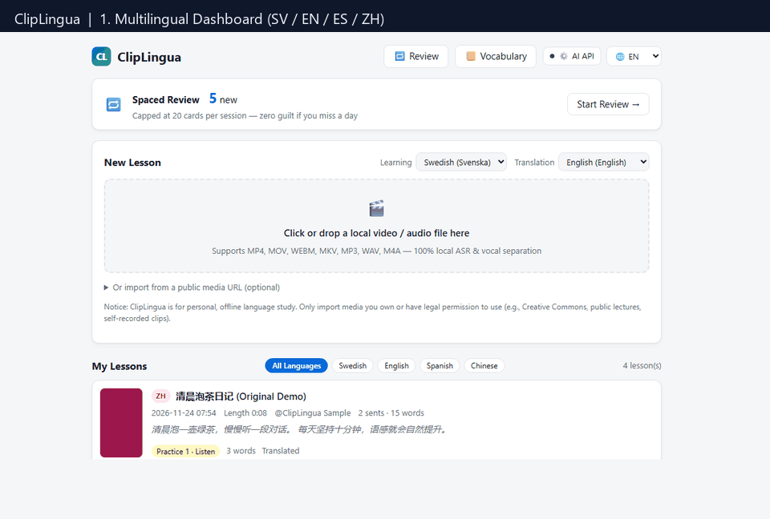
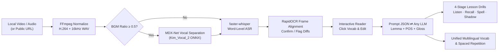

<div align="center">

# ClipLingua

**Local-First, Privacy-Preserving Multilingual Video Immersion & Spaced-Repetition Studio**

[](LICENSE)
[](https://www.python.org/)
[](#multilingual-support)
[](#architecture)

[English](README.md) · [简体中文](README.zh-CN.md)

</div>

---

**ClipLingua** turns short videos, podcasts, or personal recordings into an end-to-end active language learning loop — running **100% locally** on your machine with **zero AI API fees**:

> **Vocal Separation** → **Word-Level Timestamps** → **OCR Subtitle Cross-Check** → **Zero-API-Key Translation & Lemmatization** → **4-Stage Active Recall & Shadowing** → **Guilt-Free Spaced Repetition**

<p align="center">
  
</p>

---

## Why ClipLingua?

Most language learners either passively watch clips with subtitles (low retention) or manually copy words into flashcards (high friction). ClipLingua connects six clean engineering stages into one cohesive workflow:

1. **Adaptive Vocal Separation (`Kim_Vocal_2` ONNX)** — Automatically measures background music energy (`music_ratio`). Only isolates vocals when BGM is actually loud, cutting ASR errors on noisy clips while avoiding distortion on clean speech.
2. **Word-Level ASR (`faster-whisper`)** — Routes each language to the best local model (e.g., KBLab Swedish strict model for `sv`, multilingual `large-v3-turbo` for `zh`/`es`/`en`), with CUDA GPU acceleration and automatic CPU fallback.
3. **On-Screen OCR Cross-Check (`RapidOCR`)** — Samples video frames, strips watermarks/handles, folds diacritics (`å ä ö`, `á é í ó ú ñ`), tokenizes CJK cleanly, and aligns burned-in creator subtitles word-by-word against ASR to highlight discrepancies for human review.
4. **Zero-API-Key OR One-Click AI Translation & Lemmatization** — By default, exports a structured JSON prompt you can paste into *any* free LLM chat (ChatGPT, Claude, Gemini, DeepSeek) with zero API cost. Prefer one-click automation? Click **⚙️ AI API** in the top-right corner to add a **DeepSeek / OpenAI / Google Gemini** (or any OpenAI-compatible) API key stored locally only.
5. **Cross-Lesson Lemma Merging** — Automatically merges inflected forms (*förklarade / förklarar → förklara*, *empezamos → empezar*) under `lang|lemma|pos` so multi-language vocabularies never collide.
6. **Guilt-Free Spaced Repetition & Shadowing** — Progressive 0–5 mastery levels (`Listen → Recall → Spelling → Original-Sentence Cloze`) with hard session caps (`10/20/30`), no punishing streaks, loudness-normalized TTS (`Edge-TTS` + offline `Piper`), and sentence-level shadowing with mic recording comparison.

---

## Architecture



---

## Multilingual Support

Both the **learning target language** and the **UI / translation language** fully support all four languages in any combination:

| Language | Code | ASR Model Routing | Special Spelling Support | TTS Voices (Online / Offline) |
| :--- | :---: | :--- | :--- | :--- |
| **Swedish** (Svenska) | `sv` | Local KBLab `strict` → `large-v3-turbo` | `å ä ö` bar + `[ ' ;` shortcuts + lenient mode | Sofie, Mattias / Piper Lisa |
| **English** | `en` | Multilingual `large-v3-turbo` | Clean Latin normalization | Jenny, Guy / Piper Lessac |
| **Spanish** (Español) | `es` | Multilingual `large-v3-turbo` | `á é í ó ú ü ñ ¿ ¡` bar + lenient accents | Elvira, Álvaro / Piper Davefx |
| **Chinese** (中文) | `zh` | Multilingual `large-v3-turbo` (Simplified prompt) | CJK-aware tokenization, zero-space join & OCR | Xiaoxiao, Yunxi / Piper Huayan |

---

## Quick Start

### 1. Prerequisites
- **Python 3.10 – 3.12**
- **FFmpeg** installed on your system `PATH` (or automatically provided via `imageio-ffmpeg`)
- *(Optional)* NVIDIA GPU with CUDA 12 for fast transcription (automatically falls back to CPU `int8`)

### 2. Install
```bash
git clone https://github.com/lin635989959-ops/ClipLingua.git
cd ClipLingua

python -m venv .venv
# Windows:
.venv\Scripts\activate
# macOS / Linux:
source .venv/bin/activate

pip install -r requirements.txt
```

> **Optional: NVIDIA GPU Acceleration for OCR & Vocal Separation**  
> Default dependencies install CPU `onnxruntime` for zero-friction cross-platform setup (Windows / macOS / Linux). On machines with an NVIDIA CUDA 12 GPU, swap to `onnxruntime-gpu` and ClipLingua will automatically detect CUDA (10x+ faster OCR & vocal separation):
> ```bash
> pip uninstall -y onnxruntime
> pip install onnxruntime-gpu
> ```
> Optional tuning environment variables: `CLIPLINGUA_OCR_FPS` (default `1.5`), `CLIPLINGUA_AUTO_OCR=0` (run OCR only on demand), `CLIPLINGUA_WHISPER_BEAM` (default `2`).

### 3. Download Optional Models (On Demand)
Large model weights are intentionally excluded from Git. Download only what you need from official open-source hubs:

```bash
# Vocal separation (Kim_Vocal_2, ~67 MB)
python scripts/download_models.py --vocal

# Multilingual Whisper (faster-whisper-large-v3-turbo) or Swedish KBLab strict
python scripts/download_models.py --whisper multi
python scripts/download_models.py --whisper sv

# Optional offline Piper TTS voices (choose any of: sv en es zh)
python scripts/download_models.py --piper sv en es zh
```

*(RapidOCR downloads its lightweight ONNX models automatically into `models/ocr/` on first use.)*

### 4. Try with Copyright-Free Demo Lessons (Optional)
Want to explore the full UI immediately without importing any media?

```bash
python scripts/create_demo.py
```

*(Run `python scripts/create_demo.py --clean` anytime to remove the sample lessons.)*

### 5. Launch
```bash
# Windows (or double-click start.bat)
python app/server.py --open

# macOS / Linux
./start.sh
```
Open **http://localhost:5000** in Chrome or Edge. Your server binds strictly to `127.0.0.1` — nothing leaves your computer except optional Edge-TTS synthesis requests (which are cached locally in `tts_cache/`).

---

## Project Structure

```text
ClipLingua/
├── app/
│   ├── languages.py        # 4-language config, CJK/Latin tokenizer, Whisper routing
│   ├── vocals.py           # MDX-Net (Kim_Vocal_2) adaptive vocal separation
│   ├── transcriber.py      # faster-whisper word-level ASR & sentence grouping
│   ├── subtitles.py        # RapidOCR frame sampling & word-level diff alignment
│   ├── lemma.py            # Multilingual dictionary lemma & POS normalization
│   ├── translation.py      # Zero-API-key prompt builder & robust JSON merger
│   ├── tts.py              # Edge-TTS + offline Piper + FFmpeg loudness normalization
│   ├── records.py          # Cross-lesson vocabulary aggregation & recordings
│   ├── review.py           # Guilt-free spaced-repetition scheduler
│   ├── downloader.py       # Local video/audio importer & optional public URL loader
│   ├── server.py           # Local Flask server
│   └── web/                # Zero-build vanilla HTML/CSS/JS frontend + 4-lang i18n
├── scripts/
│   ├── download_models.py  # On-demand model downloader from official repositories
│   ├── create_demo.py      # 100% synthetic copyright-free 4-language demo generator
│   └── make_demo_gif.py    # Headless screenshot & demo GIF builder
├── tests/                  # Full-pipeline multilingual unit & API tests
└── docs/                   # Data schema & demo assets
```

### Run Tests & Environment Check
```bash
python -m unittest discover -s tests -v
python app/check_env.py
```

---

## Copyright, Privacy & Legal Disclaimer

- **Personal Educational Use Only**: ClipLingua is an offline personal language-study tool. It does **not** host, distribute, or provide access to any copyrighted media.
- **User Responsibility**: Please only import local video/audio files or public URLs that you own, recorded yourself, or have explicit legal permission / open license (e.g., Creative Commons, public domain lectures) to study.
- **Third-Party Models & Tools**: All optional models (`faster-whisper`, `KBLab/kb-whisper`, `RapidOCR`, `Kim_Vocal_2`, `Piper`) and binaries (`FFmpeg`, `yt-dlp`) are downloaded separately by the user from their respective official sources and remain governed by their own open-source licenses.
- **Local Privacy**: All lessons, recordings, progress, and review schedules are stored strictly as plain JSON/media files under `lessons/` on your local drive.

---

## Support the Project

If ClipLingua helped you break through listening comprehension or saved you hours of manual flashcard making, consider giving it a ⭐ **Star**, sharing it with fellow learners, or opening an issue/PR!

---

## License

Released under the [MIT License](LICENSE).
