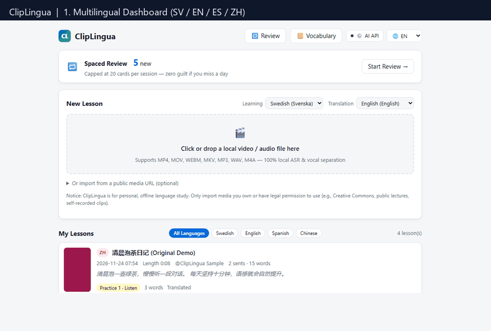
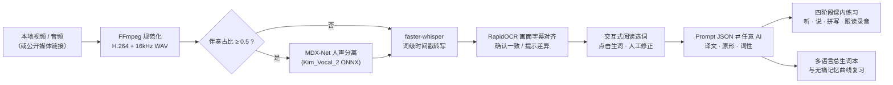

<div align="center">

# ClipLingua

**本地优先、隐私安全的多语言短视频沉浸式精学与记忆曲线工具**

[](LICENSE)
[](https://www.python.org/)
[](#四语支持矩阵)
[](#系统架构)

[English](README.md) · [简体中文](README.zh-CN.md)

</div>

---

**ClipLingua** 将本地音视频或合法公开视频转化为一套完整的语言精学闭环 —— 全程在你的电脑上 **100% 本地运行**，**无需任何 AI API Key**：

> **人声分离** → **词级时间戳转写** → **OCR 画面字幕校对** → **零 API 翻译与原形归并** → **四阶段听/说/拼/跟读** → **无痛记忆曲线复习**

<p align="center">
  
</p>

---

## 核心工程亮点

1. **自适应人声分离（`Kim_Vocal_2` ONNX）**：先计算音频的伴奏能量占比（`music_ratio`），仅在背景音乐较响时自动分离人声送入识别，既显著降低嘈杂短视频的识别错词率，又避免对纯净人声引入失真。
2. **多语言词级时间戳转写（`faster-whisper`）**：按目标学习语言自动路由最佳模型（瑞典语优先使用瑞典国家图书馆 `KBLab strict` 逐字模型，中/英/西使用多语言 `large-v3-turbo`），支持 CUDA 显卡加速并在无显卡时自动退回 CPU `int8`。
3. **OCR 画面字幕逐词校对（`RapidOCR`）**：定时抽帧跳过静止画面、过滤 `@账号`/URL 水印、兼容拉丁变音符折叠（`å ä ö`、`á é í ó ú ñ`）与中文无空格分词，将硬字幕与语音识别逐词对齐：一致词打勾确认，差异词给出建议条由人工听原声决定「采用 / 自己改 / 忽略」。
4. **零 API Key 或一键 AI 翻译与复核**：默认可一键复制任务 JSON 给任意免费网页 AI（ChatGPT / Claude / Gemini / DeepSeek 等）再粘贴导入；嫌粘贴麻烦的用户也可以点右上角 **⚙️ AI API**，选择 **DeepSeek / OpenAI / Google Gemini**（或自定义兼容接口）填入 Key（仅存本机），开启翻译页「⚡ 一键 AI 翻译」。
5. **跨课程词典原形归并（Lemma）**：同一学习语言下不同词形（如 *förklarade / förklarar → förklara*，*empezamos → empezar*）自动按 `lang|lemma|pos` 合并去重，跨语种严格隔离不串词。
6. **无痛记忆曲线 + 影子跟读**：熟练度 0–5 级自动递进题型（听音释义 → 看义说词 → 拼写 → 原句挖空），单次短清单封顶（10/20/30 词）、无连续打卡惩罚；内置响度均衡合成语音（Edge-TTS + Piper 离线兜底）与逐句跟读录音对比回放。

---

## 系统架构



---

## 四语支持矩阵

**学习目标语言**与**界面/译文语言**均完整支持以下四种语言，可任意组合（例如：中文学瑞典语/西语/英语，或英语/西语学中文）：

| 语种 | 代码 | 语音识别路由 | 拼写与分词特色 | 合成发音（在线 / 离线） |
| :--- | :---: | :--- | :--- | :--- |
| **瑞典语** (Svenska) | `sv` | KBLab `strict` → `large-v3-turbo` | `å ä ö` 工具条 + `[ ' ;` 快捷键 + 宽松模式 | Sofie / Mattias / Piper Lisa |
| **英语** (English) | `en` | 多语言 `large-v3-turbo` | 英文词形还原（自动去 `to` / 冠词） | Jenny / Guy / Piper Lessac |
| **西班牙语** (Español) | `es` | 多语言 `large-v3-turbo` | `á é í ó ú ü ñ ¿ ¡` 工具条 + 忽略重音宽松模式 | Elvira / Álvaro / Piper Davefx |
| **中文** (简体中文) | `zh` | 多语言 `large-v3-turbo`（简体引导） | 无空格 CJK 智能分词、自然无多余空格拼接与中文 OCR 对齐 | Xiaoxiao / Yunxi / Piper Huayan |

---

## 快速开始

### 1. 环境准备
- **Python 3.10 – 3.12**
- 系统已安装 **FFmpeg**（或由 `imageio-ffmpeg` 自动提供）
- *(可选)* 支持 CUDA 12 的 NVIDIA 显卡（无显卡自动使用 CPU）

### 2. 安装依赖
```bash
git clone https://github.com/lin635989959-ops/ClipLingua.git
cd ClipLingua

python -m venv .venv
# Windows:
.venv\Scripts\activate
# macOS / Linux:
source .venv/bin/activate

pip install -r requirements.txt
```

> **可选：NVIDIA GPU 加速 OCR 与人声分离**  
> 默认依赖会自动安装跨平台 CPU 版 `onnxruntime`，以保证 Windows / macOS / Linux 零配置运行。若本机配有 NVIDIA CUDA 12 显卡，执行以下两条命令替换为 `onnxruntime-gpu`，程序会自动检测并启用 GPU 加速（可提速 10 倍以上）：
> ```bash
> pip uninstall -y onnxruntime
> pip install onnxruntime-gpu
> ```
> 此外还支持通过环境变量按需微调速度：`CLIPLINGUA_OCR_FPS`（默认 `1.5`）、`CLIPLINGUA_AUTO_OCR=0`（导入后仅在手动点击时执行字幕校对）、`CLIPLINGUA_WHISPER_BEAM`（默认 `2`）。

### 3. 按需下载开源模型
为遵守体积与协议规范，模型权重不随仓库分发，可通过助手脚本从官方仓库按需拉取：

```bash
# 人声分离模型（Kim_Vocal_2，约 67 MB）
python scripts/download_models.py --vocal

# 多语言 Whisper（large-v3-turbo）或瑞典语专用 KBLab strict 模型
python scripts/download_models.py --whisper multi
python scripts/download_models.py --whisper sv

# 可选：下载各语种离线 Piper 发音模型
python scripts/download_models.py --piper sv en es zh
```

### 4. 一键生成无版权演示课程（可选）
克隆后无需导入任何第三方视频，即可体验完整学习流程：

```bash
python scripts/create_demo.py
```
*(体验完毕可随时运行 `python scripts/create_demo.py --clean` 清除演示课程。)*

### 5. 启动程序
```bash
# Windows（也可直接双击 start.bat）
python app/server.py --open

# macOS / Linux
./start.sh
```
浏览器打开 **http://localhost:5000** 即可使用（推荐使用 Chrome / Edge 以开启麦克风跟读录音）。

---

## 测试与环境自检

```bash
# 运行四语全链路单元测试与 API 集成测试
python -m unittest discover -s tests -v

# 运行本地依赖与加速环境自检
python app/check_env.py
```

---

## 版权、隐私与免责声明

- **仅限个人学习与研究**：ClipLingua 为本地离线语言学习工具，本身不提供、不托管也不分发任何受版权保护的视频或音频内容。
- **素材合规责任**：请仅导入您拥有合法版权、个人录制或采用开放许可（如 Creative Commons、公有领域公开课等）的音视频文件或公开链接。
- **第三方模型与组件**：所有可选模型（`faster-whisper`、`KBLab/kb-whisper`、`RapidOCR`、`Kim_Vocal_2`、`Piper`）及外部工具（`FFmpeg`、`yt-dlp`）均由用户按需自行获取，并各自遵循其原有开源许可协议。
- **隐私零上传**：除您主动选择在线 Edge-TTS 发音时向微软朗读服务发送单个词句文本（生成后即永久本地缓存）外，所有课程媒体、录音、生词与复习记录均完全保存在本地 `lessons/` 目录。

---

## 支持项目

如果 ClipLingua 帮到了你的外语精听与词汇积累，欢迎点亮一个 ⭐ **Star**、分享给一起学外语的朋友，或提交 Issue / PR 参与改进！

---

## 开源协议

本项目基于 [MIT License](LICENSE) 开源。
